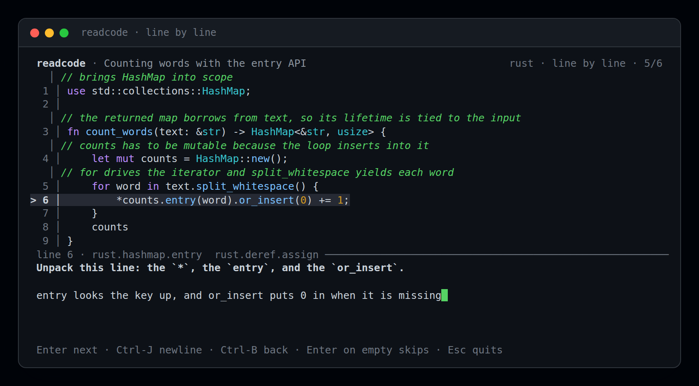
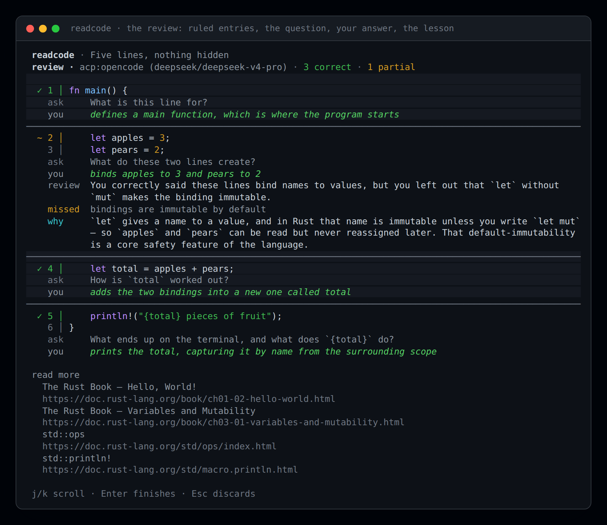

# readcode

Learn a language by annotating real code, then get graded on it.

`readcode` shows you a short piece of production-shaped code — sometimes block by block,
sometimes line by line — and asks you to explain each part in your own words. A reviewer
then marks every concept you were supposed to name: correct, partial, wrong, or unknown.
Concepts you missed come back sooner. Duolingo, aimed at *reading* code instead of
writing toy apps nobody needs.



## Install

macOS or Linux, via Homebrew. It builds from source, so it takes about a minute and
pulls in nothing you keep afterwards:

```sh
brew install OscarGTH/tap/readcode
```

On Homebrew 6 or later you may be asked to trust a third-party tap first:
`brew trust OscarGTH/tap`.

Anywhere with a Rust toolchain:

```sh
cargo install --git https://github.com/OscarGTH/readcode
```

Or from a clone: `cargo build --release`, then run `target/release/readcode`.

The snippet corpus is compiled into the binary, so a single executable is the whole
install — no data files, no network at runtime unless you choose a model or agent.

## Quick start

Point it at a reviewer once (see [Choosing a reviewer](#choosing-a-reviewer)):

```sh
export READCODE_AGENT="opencode acp"   # or: export READCODE_API_KEY=sk-...
```

Then everyday:

```sh
readcode            # annotate the snippet that is most due
readcode status     # what you have mastered, what is due
readcode list       # the snippets available, with their levels
readcode level      # what level you are reading at
readcode draft f.rs # turn a file into a draft snippet with your reviewer
readcode models     # which models your agent offers
```

The first run asks one question — how much of the language you can read — and starts you
on the easiest material that fits. Answering it honestly matters more than answering it
flatteringly: the app would rather hand you five easy lines than a file you cannot start.")["success"])

# The levels section, before "Blocks or lines".
print(patch(p, ### Levels

Every snippet is written for a rung, 1 to 5, easiest first:

```
1 · just started — values, arithmetic, printing
2 · small functions — branches, loops, one borrow at a time
3 · whole modules — structs, methods, iterators, error handling
4 · unfamiliar crates — traits, generics, lifetimes
5 · reads Rust for a living
```

`readcode level 2` sets yours, and `readcode level` shows the rungs with yours marked. The
level does two things:

- **It caps what is offered.** Snippets above your level plus one stop appearing, however
  due their concepts are. The one rung above is deliberate: a stretch you can mostly read
  is what moves you up.
- **It starts you at the bottom of that rung.** While anything at or below your level still
  has something unmastered, the app keeps choosing from it instead of drifting upward. Once
  that rung is solid, harder material joins the rotation and `readcode status` says so:
  `you have cleared level 1 (12 of 12 concepts solid) — readcode level 2 opens up harder code`.

A snippet can declare a band instead of a single rung (`levels = [2, 4]`), which is how
"this is a level 2 idea but the code itself is level 4" gets expressed.

Your level is a claim about you, not a gate: nothing stops you from running
`readcode --snippet 003` at level 2 to try the iterator chain, and it will not move your
level down if you struggle. Setting it lower is the useful direction — going back over the
easy material is cheap, and being dropped into code you cannot read teaches nothing.

### Blocks or lines

Progress is saved between runs, so `readcode` is the same command every day.

## Using it

The code fills the screen, you answer in your own words, and your answer lands **on the
code**: each note appears above the line it explains, as a `//` comment, so the snippet
turns into your own annotated copy as you go.

- `Enter` submits an answer and moves to the next question
- `Enter` on an empty answer skips that question (an honest "no idea" is fine)
- `Ctrl-J` adds a newline when one sentence is not enough
- `Ctrl-B` goes back and reopens the previous answer
- `Esc` stops without saving anything

When the last question is answered it grades you per concept and shows you the review —
what was right, what was thin, and what you missed:



Each entry keeps the code beside your answer, because the moment you want to know *why*
something was wrong is the moment you need to see what you were looking at. The verdict
rides the line it is about, so one prompt is one block rather than a heading followed by
the code it describes:

- `✓ 4 │ let total = apples + pears;` — the mark is the verdict, the line is what you read
- `you` — your words, under the code they explain
- `review` — only when something was off: what the answer did and did not say
- `missed · …` — the points it left out; a concept the reviewer could not judge from that
  answer is left out rather than marked "unknown", since a line is only asked to prove what
  it can show
- `why` — the lesson: what the code actually does, in two or three sentences. Required
  whenever the verdict is not "correct", and the whole answer when you said you did not
  know. Grading that only marks you down is not teaching.

Entries are separated by a rule as well as a slightly different background: the rule reads
in any terminal and needs no colour, and the shade helps when you are scrolling fast.

A correct line stops at `you`: praise is not information, and a review you have to scroll
through is one you stop reading. Reading comes once, at the end of the sitting, deduplicated
by topic — from a table keyed by concept namespace rather than from the model, because a
study tool that invents URLs is worse than one that stays quiet. A corpus author can add
their own with `docs = [{ title = "…", url = "…" }]`.

### When grading fails

A reviewer that answers with broken JSON does not cost you the sitting. The reply is read
tolerantly first — prose around it, a code fence, a trailing comma, a newline inside a
string, or a reply cut off mid-object are all normal model behaviour, and none of them is
worth losing six answers over. If it still cannot be read, `readcode` asks once more, and in
the full-screen view the failure leaves your answers on screen with `r` to try again.

If it keeps failing, the error names what the parser objected to and writes the reviewer's
whole reply to `$TMPDIR/readcode-last-reply.txt`, which is the file worth reporting.

```sh
readcode --snippet 002     # a specific snippet (id, or any unambiguous suffix)
readcode --lines           # force line-by-line; --blocks forces the other way
readcode --no-tui          # plain line-by-line view, for pipes and screenshots
readcode check             # validate your own snippet files
readcode reset --yes       # wipe progress and start over
```

With `--no-tui` (or when the output is piped) the same sitting runs as plain text: a line
containing only `.` finishes an answer, `:unknown` says you have no idea, `:quit` stops.

### Blocks or lines

Comprehension and attention to detail are different skills, so the app asks both:

- **block by block** — one question per semantic block: "what does `shout` take, and what
  does it give back?"
- **line by line** — one question per significant line, answered the way you would
  annotate a file: the line being asked is marked, and the lines you have already
  explained carry your note above them as a `//` comment.

A note about a single line sits above that line. A note about a block sits *after* the
block's last line, labelled with its span (`// on lines 1-5: …`), so it never reads as a
comment on whichever line happened to open the block.

You do not choose: the first visit uses whatever the snippet is authored for, and the
next visit to the same snippet **alternates** to the other mode. Same code, different
question. `--lines` / `--blocks` override it for one sitting.

### Seeing where you are

`readcode status` answers three questions and stops:

```
level 1 · just started — values, arithmetic, printing
  ███░░░░░  40%  0/9 solid at this level

  1 of 9 snippets seen · 1 new at your level
  nothing due now · next review in 24h

needs work
  rust.binding.immutable           ███░░░░░  40%  in 24h
  rust.fn.main                     ███░░░░░  40%  in 24h
  ...
```

The bar is average strength, not the count of mastered concepts: one correct answer is real
progress, and a bar that sits at 0% for three sittings says nothing moved. The strict count
(`0/9 solid`) stays next to it, because "solid" is what schedules the long intervals.

After every sitting you get one line of the same: `level 1 · 3 of 9 solid at this level`.

`readcode` never re-offers a snippet you have answered while there is anything else to do at
your level — either a snippet you have not met, or a concept that has come due again. A rung
only becomes "old" when it is actually exhausted, not when it stops feeling new.

### Where progress lives

`$XDG_DATA_HOME/readcode/progress.json`, or `~/.local/share/readcode/progress.json`.
Override with `--data-dir <dir>` — handy for trying the app without touching your real
progress.

## Choosing a reviewer

Grading needs a model, so the first run needs one of two things set up:

| `--reviewer` | Needs | What you get |
|---|---|---|
| `acp` | an ACP agent on your machine | your own agent and subscription grade; no API key |
| `api` | one API key | a model grades over one HTTP call |

Auto-detection uses a configured agent first, then a key. With neither, `readcode`
stops and tells you which exports to set — `status`, `list` and `check` work either way.
`READCODE_REVIEWER=acp` makes the choice permanent.

**With an API key** (OpenAI- or Anthropic-compatible, including local servers):

```sh
export READCODE_API_KEY=sk-...
export READCODE_MODEL=gpt-4o-mini                     # optional
export READCODE_API_BASE=http://localhost:11434/v1    # optional
export READCODE_API_STYLE=openai                      # openai | anthropic
```

**With your own agent** (anything that speaks ACP):

```sh
export READCODE_AGENT="opencode acp"     # or "copilot --acp", an adapter, ...
readcode --reviewer acp
```

**Models are never picked for you.** `--model <id>` or `READCODE_MODEL=<id>` is the only
way a model is chosen; without one, the agent's own default is used and the review line
names whatever actually answered. If that default is a free shared-queue model, `readcode`
says so once rather than switching behind your back. To see the options:

```sh
readcode models          # models the agent offers, with the current one marked
readcode --model deepseek/deepseek-v4-pro
```

## Drafting a snippet with your reviewer

Hand-writing a snippet means reading the code, choosing blocks, writing one question each,
and writing the ground truth the grader marks against. The last part is what makes grading
sharp, and it is also the slow part — so let the model draft it and keep the judging for
yourself:

```sh
readcode draft src/parser.rs                      # print a draft
readcode draft src/parser.rs --span 41-58         # just that function
readcode draft src/parser.rs --level 3 --write    # save it under ./snippets/rust/
```

It reads the file, asks your reviewer (ACP agent or BYOK key) for one snippet in the corpus
format, then fixes the id, the language and the level itself. Before it shows you anything
the draft goes through the same rules `readcode check` enforces, so a draft that arrives is
a draft that loads and plays.

Three things to expect from the header of every draft:

- `# fixed: block 2 extended from line 5 to 7 to cover the gap` — models think in ideas, not
  in partitions, so they leave blank lines and closing braces uncovered. That is unambiguous,
  so it is repaired and reported. An **overlap** is not: that means the reply is confused and
  the draft is refused with the reason.
- `# check: block 1 asks more than one question — split it in two: …` — the failure that
  hurts grading most, flagged by counting interrogatives. Two questions in one ask means one
  answer covering two things, and the note lands on whichever line opened the block.
- Concepts are reused where they already exist (`--level` aside, the draft is told the corpus'
  concept ids), so progress carries across snippets instead of fragmenting.

What it will not do is tell you whether the *questions* are good. Read the draft: the asks
are the product, and the notes are what the grader judges against. A vague note is a vague
grade, and no amount of validation catches that.

## Adding your own corpus

The built-in snippets are compiled into the binary, so plain `readcode` works anywhere.
To use your own, point it at a directory of TOML files:

```sh
readcode --corpus ~/my-snippets
readcode --corpus ~/my-snippets check      # validate before you study
```

Files are found recursively, so `~/my-snippets/rust/*.toml` and
`~/my-snippets/python/*.toml` both work. One snippet per file; the `id` must be unique.

### The smallest snippet that works

```toml
id = "rust-001"
language = "rust"
title = "Ownership: moving a String into a function"

code = '''
fn shout(mut text: String) -> String {
    text.push('!');
    text
}
'''

[[blocks]]
lines = [1, 4]
concepts = ["rust.ownership.param", "rust.ownership.return"]
```

That is a complete snippet: the code, one block covering lines 1-4, and the two concepts you
have to name. `readcode check` accepts it, block mode asks "explain what this block does",
and a reviewer grades the answer.

### Sharpening it — all optional

Two fields make grading more specific. Add them where they earn it, skip them where they
do not.

```toml
source = "adapted from The Rust Book, ch. 4.1"
intro = "Say what each block does to the data."

[[blocks]]
lines = [1, 4]
ask = "What does `shout` take, and what does it give back?"
concepts = ["rust.ownership.param", "rust.mut.param", "rust.ownership.return"]
notes = { "rust.ownership.param" = "`String` is not `Copy`: passing it by value hands ownership to `shout`.", "rust.mut.param" = "`mut text` makes the binding writable inside this function only.", "rust.ownership.return" = "The tail expression returns `text`, moving ownership back to the caller." }
```

- `ask` — the question the learner sees. Without it they get a generic one.
- `notes` — the ground truth per concept: what a correct answer has to say. The reviewer is
  shown these, so it grades against your rubric instead of guessing at the code. One line,
  only for the concepts that need it.

### Asking about single lines

In line mode every significant line is asked on its own (blank lines and lone braces are
skipped). To give one line its own question and note:

```toml
  [[blocks.line]]
  at = 2
  ask = "Why is `mut` on the parameter, and who does it help?"
  concepts = ["rust.mut.param"]
  notes = { "rust.mut.param" = "`mut text` makes the binding writable inside this function only." }
```

- `at` is a single line inside the owning block. `ask`, `concepts` and `notes` all default to
  the block's, so `at` alone is a valid entry.
- A line without one still gets "What does line N do?", graded against the block's concepts.

### Field reference

Snippet:

- `id` — unique; `--snippet` matches it, or its title. Prefix by language: `rust-001`.
- `language`, `title` — shown in the header.
- `code` — the code, in a TOML literal string (`'''`). Line numbers are 1-based.
- `source`, `intro` — optional: where the code came from, and one line saying what it
  *is*. Both are descriptive; the app already explains what the learner has to do.
- `asks` — optional: `"blocks"`, `"lines"` or `"auto"` (default: lines if the snippet has
  `blocks.line` entries, otherwise blocks).
- `docs = [{ title, url }]` — optional: reading for this snippet specifically, shown in
  the review above the per-concept links.
- `level` — optional: the rung this snippet is written for, 1 to 5. Omit it and the snippet
  is offered to everyone, which is the right default for a small personal corpus.
- `levels = [from, to]` — optional: a band, for a simple idea shown in code that is harder
  to read than the idea. `level` and `levels` are mutually exclusive.

Block:

- `lines = [start, end]` — 1-based, inclusive, in order, no gaps.
- `concepts` — what the learner must name. This is the unit of progress, not the snippet:
  mastery and scheduling are per concept, so reuse the same id wherever the idea appears.
  Namespace them (`rust.ownership.move`).
- `ask` — optional question for the block.
- `notes` — optional map of concept → ground truth for that concept.
- `line` — optional `[[blocks.line]]` entries, as above.

### Rules `readcode check` enforces

- every code line belongs to exactly one block, in order, no gaps or overlaps
- every block has at least one concept, and no empty ids
- a `notes` key has to be a concept declared on that block (or line) — this is what catches
  a typo in a concept id
- line questions sit inside their block, are not duplicated, and only use the block's concepts
- ids are unique across the corpus

When a range is wrong, `readcode check` prints the snippet with line numbers, so you never
count lines by hand to find the off-by-one.

### Tips for snippets worth studying

- **Use code you actually had to read.** A file from a repo you maintain beats a textbook
  example, because that is the skill you are training.
- **6–15 lines, 2–4 blocks.** Long enough to be real, short enough to finish in one
  sitting.
- **Say which rung it is.** `level = 1` for code a beginner can read line by line, `level = 4`
  for a lifetime puzzle in an unfamiliar crate. An unlevelled snippet is offered to
  everybody, which in practice means it lands on a beginner and stalls them.
- **One idea per block.** If a block needs two unrelated concepts, it is two blocks.
- **Write the note as the correction.** If you cannot state what the learner should have
  said in one sentence, the concept is too vague to grade — and a concept with no note is
  graded from the code alone, which is looser.
- **Reuse concept ids.** `rust.question_mark` across five snippets teaches the scheduler
  that this is one skill; five one-off ids teach it nothing.
- **One question per prompt.** If the ask needs the word "and" to join two unrelated ideas
  ("what does `use` do, and why is the error boxed?"), it is two blocks, or one block plus a
  `blocks.line` entry. A bundled question gets one answer covering two things, and then the
  answer is graded twice against two rubrics that each see half of it.
- **A line inherits its block's concepts** unless it has its own `blocks.line` entry, and
  then it is asked to prove all of them. If a block holds two ideas that land on different
  lines, give each line its own `ask` and `concepts`, or the question on each line asks for
  something that line cannot show.

## Evals

Grading can regress without any Rust test failing, so it has its own suite:

```sh
cargo run -- eval                 # deterministic mock: proves the harness itself
cargo run -- eval --target acp    # your own agent (~10 s per case)
cargo run -- eval --target api    # BYOK
```

Cases live in `evals/cases/` as one TOML file per behaviour — a misconception must never
be credited, "I don't know" must never be marked wrong, a correct idea in clumsy words
must be credited. Runs land in `evals/runs/<stamp>/` with a trace per case. See
[`evals/README.md`](evals/README.md).

## Contributing

```sh
cargo test                        # 164 tests, no network, no agent
cargo fmt --all -- --check
cargo clippy --all-targets -- -D warnings
cargo run -- eval --target mock   # what CI also runs
```

CI (`.github/workflows/ci.yml`) runs those four steps on **every push, on any branch**,
on pull requests, and on demand; superseded runs on the same ref are cancelled so a
quick fixup does not spend the minutes twice. Model-backed evals stay manual, because
they spend tokens.

The screenshots in `docs/` are not mock-ups. The full-screen ones come from
`examples/frame`, which feeds a real sitting through ratatui's test backend and hands the
resulting cells to `scripts/render_frame.py` — the same `draw` call the terminal runs, so
the frame is exact down to the cursor. The review frame is graded by a real agent, not by
hand-written verdicts. The plain view is captured from a PTY by
`scripts/capture_terminal.py` and painted by `scripts/render_terminal.py`. Regenerate with:

```sh
cargo run --quiet --example frame -- annotate /tmp/f.json
python3 scripts/render_frame.py /tmp/f.json docs/tui.html "readcode"
```

## Roadmap

- [x] Line-by-line annotation alongside block mode
- [x] A ratatui view: the code on screen, notes written on it, arrow keys instead of prompts
- [ ] More corpora: Python, TypeScript, Go, and "read your own repo" mode
- [ ] A targeted follow-up question when a concept is unknown, not just a note
- [ ] An MCP server so your agent can look up weak concepts while you work

## Licence

MIT.
