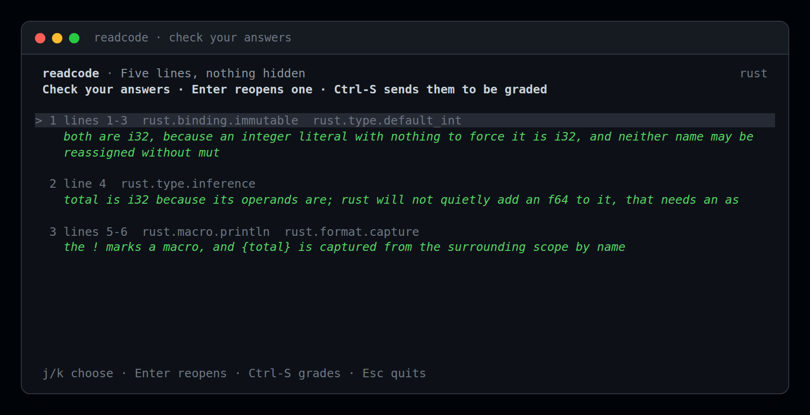

# readcode

Learn a language by annotating real code, then get graded on it.

`readcode` shows you a short piece of production-shaped code — sometimes block by block,
sometimes line by line — and asks you to explain each part in your own words. A reviewer marks
every concept you were supposed to name: correct, partial, wrong, or unknown. Concepts you
missed come back sooner. Duolingo, aimed at *reading* code instead of writing toy apps nobody
needs.


## Install

macOS or Linux, via Homebrew. It builds from source, so it takes about a minute:

```sh
brew install OscarGTH/tap/readcode
```

On Homebrew 6 or later you may be asked to trust a third-party tap first:
`brew trust OscarGTH/tap`.

Anywhere with a Rust toolchain:

```sh
cargo install --git https://github.com/OscarGTH/readcode
```

The corpus and the evals are compiled into the binary, so a single executable is the whole
install — no data files to copy, and no network at runtime unless you choose a model or agent.

## Quick start

```sh
readcode
```

The first run asks which language you want, **who should grade you** (an agent already on your
machine, or an API key), and **which model**, then writes those to
`~/.local/share/readcode/config.toml` and lists the commands worth knowing. `readcode setup`
reopens it later.

The model is never guessed: `readcode` will not grade with whatever your agent defaults to,
because that default is frequently a free shared-queue model. `readcode models` shows what the
agent offers, free tiers marked.

Everyday:

```sh
readcode            # one sitting: the snippet that is most due
readcode status     # where you are, what is due, what is next
readcode history    # past sittings, and the grading page for each
readcode lang       # the languages in the corpus, and how far you are in each
readcode level      # the rungs, with yours marked
readcode list       # every snippet, with its level
readcode setup      # change reviewer, agent or model
```

## The loop

The code fills the screen and the question is asked underneath it, beside the box you type in.
Answer in your own words and the pair lands **on the code** — the question as a dim `// ? …`
comment, your answer under it, above the lines they are about — so the snippet becomes your own
annotated copy as you go.

- `Enter` submits and moves on; `Enter` on an empty answer skips that question
- `Ctrl-J` adds a newline, `Ctrl-B` goes back and reopens the previous answer
- `Esc` stops — and keeps what you have written

When the last prompt is answered you get a **check screen** rather than a model call: the code
with every note on it, the answer you are on quoted below, `j`/`k` to walk them, `Enter` to
reopen one. `Ctrl-S` sends them; nothing is graded before that.



Then the review, per prompt: the question, your answer, the code they were about with the
verdict on its first row, what you missed, the lesson, and reading.


- `why` appears on every prompt, right answers included: a right answer can be a guess, and the
  mechanism is the part worth keeping
- `docs` sits under the entry it belongs to, from a table keyed by concept — a study tool that
  invents URLs is worse than one that stays quiet
- a concept the reviewer could not judge from that answer is left out rather than marked
  "unknown", since a line is only asked to prove what it can show

Every graded sitting is kept, so the page is not something you see once:

```sh
readcode history      # when, what, and how it went
readcode history 2    # that grading page again, scrollable
```

## Blocks or lines

Comprehension and attention to detail are different skills, so the app asks both. The first
visit uses what the snippet was authored for; the next visit to the same snippet alternates.
`--lines` / `--blocks` override it for one sitting.

Line mode needs a snippet whose lines were authored one by one. When nobody said what each
line teaches, `readcode` asks the block instead and says so — asking every line and grading it
against the whole block is how a correct answer about an `if` gets marked down for not
mentioning the `append` on the next line.

## Where you are

```
go · level 2 · small functions — branches, loops, one thing at a time
  1 ████████ 100%  9/9 solid
  2 ████░░░░  52%  2/9 solid  ← you are here
  3 ░░░░░░░░   0%  0/12 solid

  snippets  4 of 8 seen · 2 new at your level
  concepts  11 started · 11 solid · 3 not started

needs work
  go.slice.header                    ███░░░░░  40%
  go.append                          ██░░░░░░  25%

  other languages · rust 3/15 — `readcode lang <name>` switches
```

Each rung's bar is the average strength of its concepts, so one correct answer moves it, while
`solid` is the strict measure (three correct answers) that schedules the long intervals. No
dates anywhere: when something comes back is the app's business.

`level` caps what is offered at your rung plus one — a stretch you can mostly read is what
moves you up — and keeps choosing from the bottom until that rung is exhausted, so easy
material is finished rather than skipped. Your level is a claim about you, not a gate:
`--snippet rust-003` will still hand you the iterator chain.

Languages are separate: each keeps its own level, its own seen snippets and its own concepts,
and `readcode status` counts only the one you are in. Most ideas are taught by more than one
snippet on purpose — `rust.return.value` appears in eight — so a concept you meet again comes
back in different code.


## Reviewers

| `--reviewer` | Needs | What you get |
|---|---|---|
| `acp` | an ACP agent on your machine | your own agent and subscription grade; no API key |
| `api` | one API key | a model grades over one HTTP call |

An ACP agent needs a pinned model — `--model <id>`, `READCODE_MODEL`, or the settings file —
with no fallback to the agent's default. Before the first question `readcode` opens the agent
once to check the id is one it offers, so a model it cannot run costs a second instead of a
sitting.

For an API key: `READCODE_API_KEY`, plus optional `READCODE_API_BASE`, `READCODE_API_STYLE`
(`openai` or `anthropic`) and `READCODE_MODEL`. For an agent: `READCODE_AGENT="opencode acp"`
or whatever speaks ACP. Environment beats the settings file, so
`READCODE_MODEL=… readcode` overrides for one run; the key is deliberately never written to
disk.

## When something goes wrong

A reviewer that answers with broken JSON does not cost you the sitting: the reply is read
tolerantly, retried once, and the whole reply is written to `$TMPDIR/readcode-last-reply.txt`
if it still fails — that is the file worth reporting. In the full-screen view a failure leaves
your answers on screen with `r` to try again.

`The requested model is not supported. (code -32603)` is the agent's provider refusing, not
`readcode` misbehaving: the id was accepted as a setting but is unavailable in that session —
usually a lapsed login or a model withdrawn upstream. The error says so and points at
`readcode models`.

```sh
readcode --snippet 002     # a specific snippet by id, or any unambiguous suffix
readcode --lines           # force line-by-line; --blocks forces the other way
readcode --no-tui          # plain text, for pipes and scripts (`.` ends an answer, `:quit` stops)
readcode check             # validate your own snippet files
readcode reset --yes       # wipe progress and start over
```

Progress lives in `$XDG_DATA_HOME/readcode/` (or `~/.local/share/readcode/`): `progress.json`,
`config.toml`, `history.json` and `draft.json` for a sitting you left. `--data-dir <dir>`
points all of it somewhere else.

## Building a corpus

The shipped corpus is 21 Rust snippets and 8 Go ones; `readcode list` shows them with their
levels. To write your own — the format, the field reference, the rules `check` enforces, the
line-prompt rules, and how `readcode draft` turns a file into a snippet — see
[`docs/corpus.md`](docs/corpus.md).

## Evals

Grading can regress without any Rust test failing, so it has its own suite. See
[`docs/evals.md`](docs/evals.md).

## Contributing

```sh
cargo test                        # no network, no agent
cargo fmt --all -- --check
cargo clippy --all-targets -- -D warnings
cargo run -- eval --target mock   # what CI also runs
```

CI runs those four steps on every push, on pull requests, and on demand. Model-backed evals
stay manual because they spend tokens.

The screenshots in `docs/` are not mock-ups: the full-screen ones come from `examples/frame`,
which runs a real sitting through ratatui's test backend, and `scripts/render_frame.py` paints
the resulting cells. The review frame is graded by a real agent.

## Roadmap

- [x] Line-by-line annotation alongside block mode
- [x] A second language (Go), with its own level and progress
- [x] A history of grading results
- [ ] More corpora: Python, TypeScript, and "read your own repo" mode
- [ ] A targeted follow-up question when a concept is unknown, not just a note
- [ ] An MCP server so your agent can look up weak concepts while you work

## Licence

MIT.
